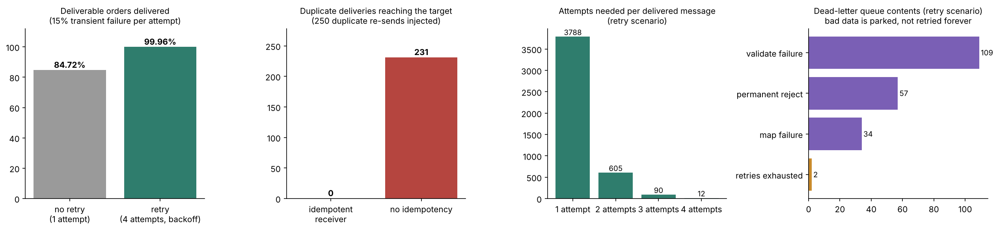

# MCP Server + Integration Flows + Go-Live Kit
**Three reusable building blocks for AI-agent customer engagements:** an MCP server exposing business tools, a config-driven integration-flow engine with retry/DLQ/idempotency, and a workshop-to-hypercare delivery kit with a project scaffold.
Built as a portfolio project for an *AI Factory Associate Consultant* profile (MCP connections, integration flows, customer implementations, reusable assets).



## 1. MCP server (`mcp_server/`)
Exposes five procurement tools, two resources (`policy://procurement`, `catalog://materials`) and a prompt (`replenishment_review`) over the Model Context Protocol (MCP Python SDK 1.x, stdio transport).
- Tools carry **annotations** (read tools read-only + idempotent; the write tool non-destructive + idempotent) and **structured output** schemas.
- The write tool is **idempotent on `request_id`** - a retrying agent cannot create two requisitions.
- Business refusals (`approval_required`, `denied`) are normal results the agent must read; invalid input is an MCP tool error.
- Approval policy is enforced **server-side**, so it holds for every client/model.
- Tested over the in-memory client **and a real stdio subprocess**.

## 2. Integration-flow engine (`integration/`)
YAML-defined flows - `validate -> map -> route -> deliver` - with exponential-backoff retry, dead-letter queue + re-drive, idempotent receive, and a correlation-ID trail. Two flows ship (`orders_to_s4`, `supplier_sync`); the second is pure configuration.

### Measured behaviour (reproducible: `make sim`)
Seeded stream of 5,250 messages through a 15%-flaky target:

| | retry + idempotency | no retry | no idempotency |
|---|---|---|---|
| Deliverable orders delivered | **99.96%** | 84.72% | 99.98% |
| Duplicate deliveries at target | **0** | 0 | **231** |

Re-drive recovered 2/2 exhausted messages once the target was healthy; all injected malformed/poison messages were classified into the correct DLQ bucket. Full table: [`docs/simulation_report.md`](docs/simulation_report.md).

## 3. Go-live kit (`golive_kit/`) and project scaffold (`templates/`, `scripts/new_agent.py`)
Eight reusable documents (discovery agenda + questionnaire, functional-spec template, test plan/UAT, cutover runbook, hypercare plan, security & responsible-AI checklist, demo script) and an **agent project skeleton**:
```bash
python scripts/new_agent.py "Invoice Triage Agent" --out ./invoice-triage-agent
```
`tests/test_scaffold.py` generates a project and runs *its* tests and evals, so the template can't silently rot.

## Read this before quoting anything
- The integration engine is a **Python stand-in demonstrating integration patterns - not SAP Integration Suite** and not its flow format. Simulations use mock targets and a virtual clock; state is in memory.
- The MCP server wraps an **in-memory mock backend** with simplified, non-SAP schemas. No live agent/host or real S/4HANA system was connected.
- Nothing here has been deployed to SAP BTP.
- The go-live documents are generic templates; the worked examples are in the other two projects.

## Layout
```
core/          mock procurement service (idempotent writes, approval policy)
mcp_server/    FastMCP server (tools, resources, prompt)
integration/   engine.py, adapters.py, simulate.py, flows/*.yaml
golive_kit/    00-08 delivery documents
templates/     agent-skeleton (+ scripts/new_agent.py scaffold)
results/       simulation.json
tests/         35 tests (MCP, engine, simulation, scaffold)
docs/          architecture.md, simulation_report.md, img/
```

## Quickstart
```bash
pip install -r requirements.txt
make test sim charts docs
python -m mcp_server.server        # stdio MCP server (point any MCP host at it)
```

## JD alignment
| JD line | Where |
|---|---|
| Model Context Protocol (MCP) connections | `mcp_server/` (stdio + in-memory tested) |
| Develop integration flows (SAP Integration Suite) | `integration/` - patterns only; platform not used |
| Support customer implementations from workshops to go-live - preparing specifications | `golive_kit/` |
| Contribute reusable assets to the Global AI Factory - samples, templates, demo content | `templates/agent-skeleton`, `scripts/new_agent.py`, `golive_kit/08_demo_script.md` |
| Standards for code review, Git, security, CI/CD | tests + `.github/workflows/ci.yml`, security checklist |

## Resume bullets (accurate as built)
- Built an MCP server (tools with annotations and structured output, resources, prompt) with server-side approval policy and idempotent writes; tested in-memory and over a real stdio transport.
- Implemented a YAML-driven integration-flow engine (validate/map/route/deliver, exponential-backoff retry, dead-letter queue with re-drive, idempotent receive, correlation-ID tracing) and quantified it in a seeded chaos simulation: 99.96% of deliverable orders delivered vs 84.72% without retry, 0 vs 231 duplicate deliveries with/without idempotency.
- Authored a workshop-to-hypercare delivery kit and a tested agent-project scaffold (35 tests in the repo) as reusable team assets.
