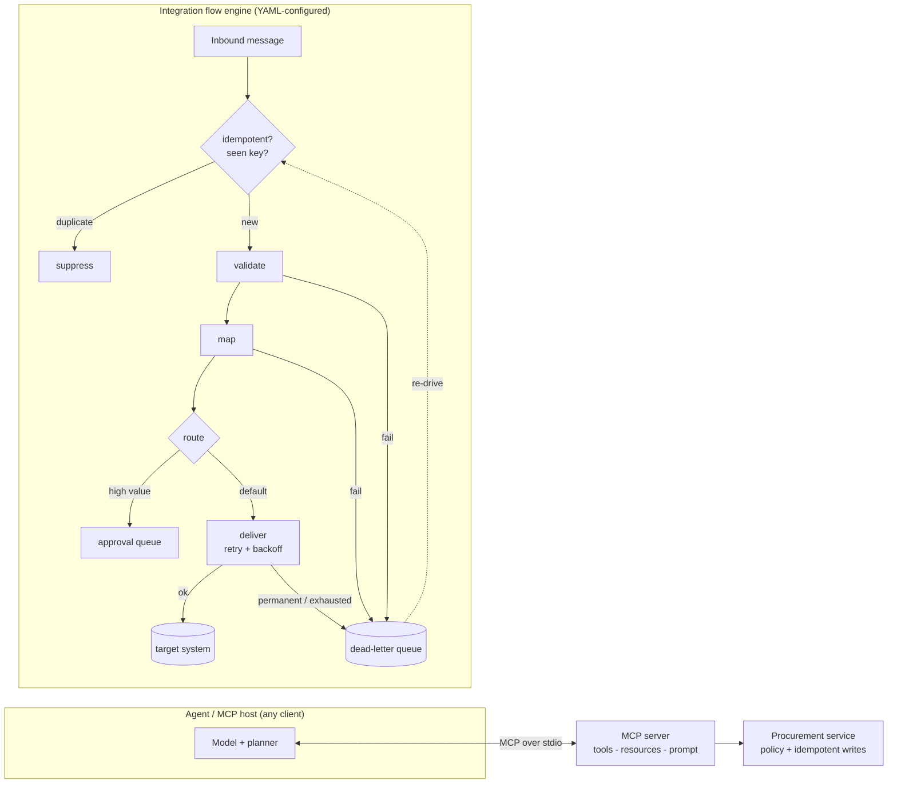

# Architecture

## MCP design decisions
| Decision | Why |
|---|---|
| Tool annotations (read-only, idempotent, non-destructive) | Lets hosts decide what needs user confirmation; documents intent. |
| Business refusals are normal results, protocol errors only for invalid input | The agent must be able to read "approval_required" and explain it, not treat it as a crash. |
| Idempotency key (`request_id`) on the write tool | Agents and transports retry; a retry must not duplicate a business document. |
| Policy enforced in the server | Holds for every client and model, including a misbehaving one. |
| Resources + prompt, not only tools | Policy text and the review workflow are discoverable by any host. |

## Integration-flow design decisions
| Pattern | Implementation |
|---|---|
| Config over code | Flows are YAML (validate / map / route / deliver, retry policy, idempotency key); the second flow needed no code. |
| Retry only what can succeed | Transient errors retried with capped exponential backoff; permanent errors go straight to the DLQ. |
| Never lose, never double | Failed messages are *not* marked processed (so they can be re-driven); successful ones are, so replays are suppressed. |
| Dead-letter + re-drive | Original payload kept with stage/reason/attempts; re-drive preserves the correlation ID and can be filtered. |
| Observability | One correlation ID across receive -> route -> deliver events in an audit trail. |

## Mapping to the SAP stack in the JD
| Here | SAP side | Status |
|---|---|---|
| `mcp_server/` | MCP connections for agents on SAP AI Core / Joule Studio | Server works with any MCP client; no SAP host tested |
| `integration/engine.py` + flows | SAP Integration Suite iFlows | **Pattern stand-in only** - not the product, runtime or flow format |
| `core/` mock backend | S/4HANA / ECC via REST/OData | Simplified non-SAP schemas |
| `golive_kit/`, `templates/` | Global AI Factory reusable assets | Generic templates, ready to adapt |
